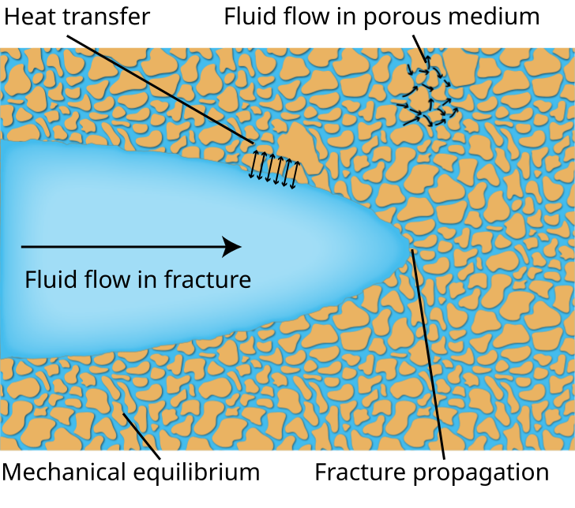

## Three-point bending

::: {.model-equations}

| Fields | Equations | BCs |
|:---|:---|:---|
| $\boldsymbol{u}(\boldsymbol{x},t)$ | $\operatorname{div}(\underline{\boldsymbol{\sigma}})+\bar{\boldsymbol{b}}=\boldsymbol{0}$ | $\begin{aligned}\boldsymbol{u}&=\bar{\boldsymbol{u}} &&\text{on }\partial\mathcal{B}_{u}\times[0,T]\\ \underline{\boldsymbol{\sigma}}\boldsymbol{n}&=\bar{\boldsymbol{t}} &&\text{on }\partial\mathcal{B}_{t}\times[0,T]\end{aligned}$ |
| $d(\boldsymbol{x},t)$ | $\operatorname{div}\boldsymbol{q}_{d}-\underline{\mathcal{H}}_{d}+f_{d}=0$ | $\boldsymbol{q}_{d}\cdot\boldsymbol{n}_{\mathcal{L}}=0\quad\text{on }\partial\mathcal{L}\times[0,T]$ |

:::

Crack propagation from a notch, modeled with a phase-field formulation.

<video class="research-video" controls loop playsinline preload="none" poster="fig/three-point-bending.webp" aria-label="Phase-field simulation of crack propagation in a three-point bending test">
  <source src="fig/three-point-bending.mp4" type="video/mp4">
  
<a href="fig/three-point-bending.mp4">Download the crack-propagation video.</a>

</video>

::: {.video-caption}
Damage field $d$ on the deformed mesh. Displacements are magnified **15×** for visibility. The inset shows the notch and propagating crack. Playback follows 100 saved simulation steps.
:::

## Fluid–solid interaction

{.interaction-image width="760"}

::: {.figure-note}
An illustration from my [doctoral thesis](https://open.metu.edu.tr/handle/11511/118360), showing the coupled processes involved in hydraulic fracturing of porous media. Drawing by Muhittin Babaoglu.

:::
