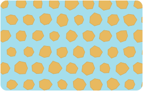
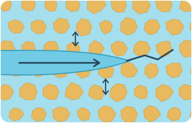

::: {#profile-content}

## Eğitim

**Doktora**, İnşaat Mühendisliği, Orta Doğu Teknik Üniversitesi, 2025

**Yüksek Lisans**, İnşaat Mühendisliği, Orta Doğu Teknik Üniversitesi, 2020

**Lisans**, İnşaat Mühendisliği, Orta Doğu Teknik Üniversitesi, 2015

:::

## Araştırma Alanları

<ul class="research-areas">
  <li>Kırılma Mekaniği</li>
  <li>Geomekanik</li>
  <li>Hesaplamalı Modelleme</li>
  <li>Hidrolik Kırılma</li>
</ul>

<figure class="research-schematic">
  <ol class="research-process">
    <li>Gözenekli ortam</li>
    <li>Akışkan–katı etkileşimi</li>
    <li>Hesaplamalı model</li>
  </ol>
</figure>

[Simülasyonları inceleyin →](simulations.qmd)
