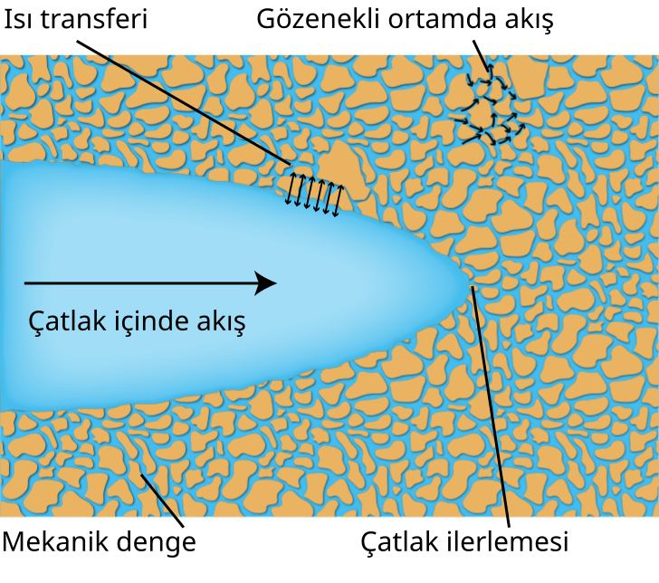

## Üç noktalı eğilme

::: {.model-equations}

| Alanlar | Denklemler | Sınır koşulları |
|:---|:---|:---|
| $\boldsymbol{u}(\boldsymbol{x},t)$ | $\operatorname{div}(\underline{\boldsymbol{\sigma}})+\bar{\boldsymbol{b}}=\boldsymbol{0}$ | $\begin{aligned}\boldsymbol{u}&=\bar{\boldsymbol{u}} &&\partial\mathcal{B}_{u}\times[0,T]\text{ üzerinde}\\ \underline{\boldsymbol{\sigma}}\boldsymbol{n}&=\bar{\boldsymbol{t}} &&\partial\mathcal{B}_{t}\times[0,T]\text{ üzerinde}\end{aligned}$ |
| $d(\boldsymbol{x},t)$ | $\operatorname{div}\boldsymbol{q}_{d}-\underline{\mathcal{H}}_{d}+f_{d}=0$ | $\boldsymbol{q}_{d}\cdot\boldsymbol{n}_{\mathcal{L}}=0\quad\partial\mathcal{L}\times[0,T]\text{ üzerinde}$ |

:::

Faz alanı yöntemiyle modellenen, çentikten başlayan çatlak ilerlemesi.

<video class="research-video" controls loop playsinline preload="none" poster="../fig/three-point-bending.webp" aria-label="Üç noktalı eğilme deneyinde çatlak ilerlemesinin faz alanı yöntemiyle modellenmesi">
  <source src="../fig/three-point-bending.mp4" type="video/mp4">
  
<a href="../fig/three-point-bending.mp4">Çatlak ilerlemesi videosunu indirin.</a>

</video>

::: {.video-caption}
Deforme olmuş ağ üzerinde hasar alanı $d$. Yer değiştirmeler, daha iyi görülebilmesi için **15 kat** büyütülmüştür. Yakın görünüm, çentiği ve ilerleyen çatlağı gösterir. Video, kaydedilmiş 100 çözüm adımını izler.
:::

## Akışkan–katı etkileşimi

{.interaction-image width="760"}

::: {.figure-note}
[Doktora tezimden](https://open.metu.edu.tr/handle/11511/118360) bir çizim: gözenekli ortamlarda hidrolik kırılmayı etkileyen bağlı fiziksel süreçler. Çizim: Muhittin Babaoglu.

:::
